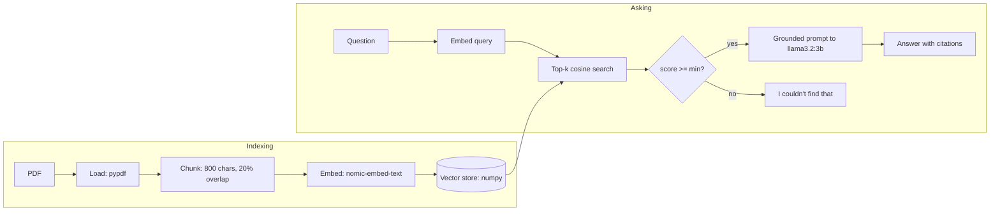

# Chat with your PDFs: local RAG from scratch
 
Ask questions about your PDFs and get answers grounded in them, with page citations.
Runs fully offline on a Mac with Ollama. The RAG pipeline is hand-written (no LangChain),
and every answer shows the retrieved chunks, their similarity scores and the exact prompt.
 

https://github.com/user-attachments/assets/5777758a-95ce-4096-b710-172a04a1358e

 
## Architecture
 

 
## Tech stack
Python · Ollama · Llama 3.2 (3B) · nomic-embed-text · NumPy · Streamlit · pypdf · pytest
 
## Key design decisions
- **No framework:** every RAG step is written by hand, so each one can be explained and tuned.
- **Own vector store:** normalized embeddings in a NumPy matrix, so search is a single matrix multiply (exact cosine similarity).
- **Two layers against hallucination:** a similarity threshold refuses before the LLM is called, and a grounded prompt forbids outside knowledge and requires page citations.
- **Explainable by design:** the UI shows the retrieved chunks, scores and prompt, so a wrong answer can be traced to retrieval or to generation.
- **Tested offline:** chunking, search ranking, persistence and the refusal path are unit-tested with fake vectors.
 
## What I learned
- **Built every RAG stage hands-on:** ingestion, chunking, embedding, vector search,
  thresholding and grounded generation. Writing each step myself, without a framework,
  showed me what each one contributes and where answers go wrong.
- **Chunk size and top-k depend on each other:** the context the model sees is roughly
  chunk size × k. Small chunks need a higher k to cover a full answer, while large chunks
  with a high k flood the prompt with noise. Changing one means re-tuning the other.
- **Retrieval settings affect speed, not just quality:** more context makes the 3B model
  slower to answer, and smaller chunks mean more embeddings to compute at indexing time.
  The best setting balances answer quality against latency.
- **Real data breaks pipelines:** math symbols in research PDFs came out of extraction as
  invalid Unicode and crashed embedding. I fixed it with a normalization step in ingestion
  and a regression test.
 
## Source code
The source is in a private repository and is available on request.
